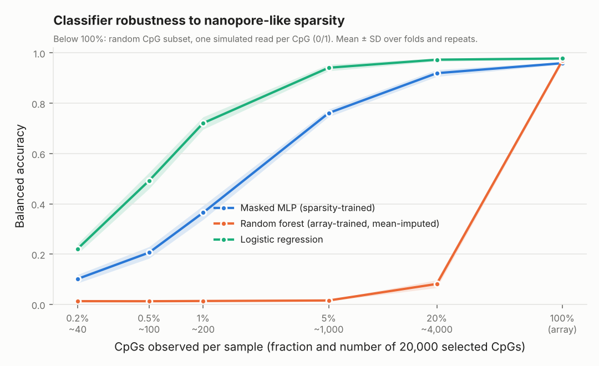

# methylsparse

**How robust are DNA methylation tumour classifiers when only a small, random
fraction of CpGs is observed, as in low-pass nanopore sequencing?**

Methylation-based classifiers such as the CNS tumour classifier of Capper et al.
(2018) are trained on Illumina arrays, where every sample has a value for every
probe. Rapid nanopore runs observe only a random subset of CpGs per sample,
usually with a single read each (so 0 or 1 instead of a beta value between 0
and 1). This repo simulates that on the public reference cohort (GSE90496) and
compares three classifiers across sparsity levels.

**This is not a new method.** It re-implements, at small scale, the core idea
behind Sturgeon (train on array data turned into simulated sparse profiles)
and crossNN (masked training of a simple model), to understand the problem and
to have a clean, reproducible benchmark to build on. See [Related work](#related-work).

| model | trained on | what it does with missing CpGs |
|---|---|---|
| Logistic regression (L2) | complete array data | fills with training mean |
| Random forest | complete array data | fills with training mean |
| Masked MLP (PyTorch) | array data with random CpG dropout and simulated single reads | sees an explicit "observed" mask |

## Results on GSE90496

5-fold stratified cross-validation, 3 random masks per sparsity level and fold.
76 methylation classes with at least 10 samples (2,673 of 2,801 samples),
20,000 most variable CpGs. Below 100%, each CpG is kept independently with the
given probability and replaced by one simulated read (Bernoulli draw from its
beta value).



| CpGs observed | Logistic regression | Masked MLP | Random forest |
|---|---:|---:|---:|
| 100% (array) | 0.978 ± 0.005 | 0.959 ± 0.005 | 0.969 ± 0.009 |
| 20% (~4,000) | 0.973 ± 0.006 | 0.919 ± 0.014 | 0.082 ± 0.015 |
| 5% (~1,000) | 0.941 ± 0.013 | 0.761 ± 0.015 | 0.016 ± 0.002 |
| 1% (~200) | 0.721 ± 0.025 | 0.365 ± 0.028 | 0.014 ± 0.001 |
| 0.5% (~100) | 0.492 ± 0.032 | 0.206 ± 0.023 | 0.013 ± 0.001 |
| 0.2% (~40) | 0.222 ± 0.020 | 0.102 ± 0.017 | 0.013 ± 0.000 |

Balanced accuracy, mean ± SD over folds and repeats. Full table with macro F1,
mean confidence and calibration error: [docs/results/gse90496_summary.md](docs/results/gse90496_summary.md);
raw per-fold results: [docs/results/gse90496_results.csv](docs/results/gse90496_results.csv).

### What this shows

1. **A plain linear model, trained only on complete array data, stays accurate
   down to about 1,000 binary CpG observations** (balanced accuracy 0.94 at
   5%). This is in line with crossNN's choice of a linear model.
2. **Its probabilities do not survive the sparsity.** The mean top-class
   probability falls from 0.96 on array data to 0.03 at 5% (with 76 classes,
   uniform would be 0.013); expected calibration error rises from 0.02 to 0.90.
   The ranking of classes stays right, but the scores become far too flat, so a
   fixed confidence cutoff such as 0.9 would reject nearly every sparse
   sample. A likely reason: mean-filled CpGs contribute nothing after
   standardisation, so the logits shrink with the observed fraction.
   Sparsity-specific recalibration is needed (crossNN uses platform-specific
   cutoffs).
3. **A random forest trained on arrays and fed mean-filled sparse data
   collapses already at 20%.** This is a property of that naive setup, not of
   random forests in general; it shows why ad-hoc retraining (Euskirchen et al.)
   or training on simulated sparse data (Sturgeon) is used in practice.
4. **The sparsity-trained MLP does not beat the linear model at any level.** It
   is untuned (one architecture, no hyperparameter search, training loss still
   falling at the last epoch), so this says little about neural networks in
   general, but extra capacity alone does not help here.

### Limitations

- **Simulation, not real nanopore data.** CpGs are dropped independently;
  real reads cover contiguous stretches (neighbouring CpGs are observed
  together), carry basecalling and modification-calling errors, and only part
  of a genome-wide low-pass run overlaps array CpGs. The absolute CpG numbers
  above do not transfer directly to real runs.
- **Reduced feature space.** 20,000 most variable probes, selected once on the
  whole cohort (unsupervised, but outside the CV loop). Production
  classifiers use all ~430,000 probes.
- **Rare classes excluded.** 15 classes with fewer than 10 samples are left
  out, which are exactly the hard cases.
- **No batch adjustment.** The GEO matrix is Illumina-normalised without
  FFPE/frozen correction.
- **One cohort, one seed, untuned models.** No external validation yet.

### Next steps

- [ ] Per-sparsity temperature scaling, fitted inside the training fold, plus an abstention rule: accuracy vs. fraction of samples classified
- [ ] crossNN-style baseline (+1 / -1 / 0 binarised input, masked training) on all probes
- [ ] Read-level simulation (contiguous reads) instead of independent CpGs
- [ ] External validation on GSE109379 (see below)
- [ ] Rare classes: shrink a large class to 5, 10, 20 training cases ("artificially rare") and test leave-one-class-out detection
- [ ] Set transformer: each observed CpG as a token, no fixed input size
- [ ] Attribution (integrated gradients / SHAP): which CpGs drive a call under sparsity

## Related work

- Capper D. et al. DNA methylation-based classification of central nervous
  system tumours. *Nature* 555, 469-474 (2018). Reference cohort and random
  forest classifier; training code at [mwsill/mnp_training](https://github.com/mwsill/mnp_training).
- Euskirchen P. et al. Same-day genomic and epigenomic diagnosis of brain
  tumors using real-time nanopore sequencing. *Acta Neuropathologica* (2017).
  Ad-hoc random forest per sample.
- Vermeulen C. et al. Ultra-fast deep-learned CNS tumour classification during
  surgery. *Nature* 622, 842-849 (2023). [doi:10.1038/s41586-023-06615-2](https://doi.org/10.1038/s41586-023-06615-2).
  Neural network trained on simulated sparse profiles (Sturgeon).
- Yuan D. et al. crossNN is an explainable framework for cross-platform DNA
  methylation-based classification of tumors. *Nature Cancer* 6 (2025).
  [doi:10.1038/s43018-025-00976-5](https://doi.org/10.1038/s43018-025-00976-5).
  Masked training of a single-layer model across arrays and sequencing.
- Benfatto S. et al. Explainable artificial intelligence of DNA
  methylation-based brain tumor diagnostics. *Nature Communications* 16, 1787
  (2025). [doi:10.1038/s41467-025-57078-0](https://doi.org/10.1038/s41467-025-57078-0).

## Setup

```bash
python -m venv .venv && source .venv/bin/activate
pip install -e ".[dev]"
pytest -q                        # end-to-end test on synthetic GEO-like data
```

GPU: if `torch.cuda.is_available()` is `False` with a "driver too old"
warning, install a wheel that matches the driver, e.g. for CUDA 12.4 drivers:
`pip install torch==2.6.0 --index-url https://download.pytorch.org/whl/cu124`.

## Running on GSE90496

### 1. Download

```bash
methylsparse download --gse GSE90496 --suppl auto --filters
```

Fetches the series matrix (sample annotation incl. `methylation class` and
`material`), the processed beta matrix `GSE90496_beta.txt.gz` (~10 GB) and the
probe filter lists published with the original training code.

### 2. Inspect (1 minute, do this first)

```bash
methylsparse inspect \
  --series data/raw/GSE90496/GSE90496_series_matrix.txt.gz \
  --beta   data/raw/GSE90496/GSE90496_beta.txt.gz
```

Shows the annotation fields, the class distribution, the beta-file header and
whether matrix columns can be matched to GSM ids. In GSE90496 the matrix
columns are named `SAMPLE 1..2801` and are matched via the sample number in the
series-matrix title (`GBM, G34, sample 1 [reference set]`).

### 3. Prepare (streams the multi-GB file once)

```bash
methylsparse prepare \
  --beta    data/raw/GSE90496/GSE90496_beta.txt.gz \
  --series  data/raw/GSE90496/GSE90496_series_matrix.txt.gz \
  --exclude data/filters/*.txt \
  --n-top   20000 \
  --out     data/processed/gse90496.npz
```

Keeps `cg` probes not on the filter lists, selects the 20,000 most variable and
imputes any remaining NaNs with the probe median. The GEO matrix is already
filtered (428,799 probes), so the filter lists remove nothing there. On a
remote machine, run it inside `tmux` so a dropped SSH connection does not kill
it.

### 4. Benchmark

```bash
methylsparse run --data data/processed/gse90496.npz --out results/quick --quick   # 2 folds, small models
methylsparse run --data data/processed/gse90496.npz --out results/full            # as reported above
methylsparse summary --results results/full/results.csv                           # markdown tables

# paediatric-focused subset
methylsparse run --data data/processed/gse90496.npz --out results/paed \
  --classes '^(MB|EPN|ATRT|ETMR|CNS NB|PLEX, PED)'
```

Outputs `results.csv` (one row per fold x model x sparsity level x repeat),
`config.json` and `balanced_accuracy_vs_sparsity_cv.png`. Sparsity levels are
set with `--levels 1,0.2b,0.05b,0.01b,0.005b,0.002b` (fraction of CpGs kept;
suffix `b` = binarised single reads). Metrics: balanced accuracy, macro F1,
accuracy, mean confidence, expected calibration error (15 bins).

Fit time per fold on a workstation with an RTX A6000: random forest (500 trees)
~4 s, logistic regression ~12 s, masked MLP ~6 s on the GPU.

### 5. External validation (GSE109379, optional)

```bash
methylsparse download --gse GSE109379 --suppl auto
methylsparse inspect  --series data/raw/GSE109379/GSE109379_series_matrix.txt.gz --beta ...
methylsparse prepare  --beta ... --series data/raw/GSE109379/GSE109379_series_matrix.txt.gz \
  --probes-from data/processed/gse90496.npz --out data/processed/gse109379.npz \
  [--label-col "<column holding the class>"]
methylsparse run --data data/processed/gse90496.npz --out results/full \
  --external data/processed/gse109379.npz
```

Only external samples whose class exists in the training data are scored.

### Alternative: start from raw IDATs

If no usable processed matrix is available, download `GSE90496_RAW.tar`,
extract it and run `scripts/preprocess_idat.R` (minfi, noob normalisation,
batches of 200 samples). It writes GSM-labelled batch files that `prepare`
streams side by side:

```bash
Rscript scripts/preprocess_idat.R GSE90496 data/raw/GSE90496/GSE90496_RAW data/beta_batches/GSE90496
methylsparse prepare --beta data/beta_batches/GSE90496/beta_batch_*.csv.gz \
  --series data/raw/GSE90496/GSE90496_series_matrix.txt.gz --exclude data/filters/*.txt \
  --out data/processed/gse90496.npz
```

## Design notes

- **Sparsity model.** Each CpG is kept independently with probability `keep`;
  a kept value becomes a Bernoulli(beta) draw (one read). All models see the
  same masks in a given fold.
- **Masked MLP input.** Per CpG `[x - 0.5 if observed else 0, observed]`, so
  "unmethylated" and "not measured" are different inputs. Training draws a
  log-uniform keep fraction per sample (0.2% to 100%) and binarises 70% of the
  sparse samples.
- **Class imbalance.** Balanced class weights everywhere; balanced accuracy and
  macro F1 as headline metrics.

## About this project

A personal learning project. Most of the code was written with the help of an
AI assistant (Claude, Anthropic); I ran the experiments on GSE90496 and checked
and interpreted the results.

## Layout

```
src/methylsparse/
  geo.py         GEO URLs, downloads, series-matrix parser
  beta_io.py     streaming reader for large beta matrices, column -> GSM mapping
  prepare.py     two-pass filter + top-variance selection -> .npz
  sparsity.py    nanopore-like masking and read simulation
  models.py      random forest, logistic regression, masked MLP
  evaluate.py    CV across sparsity levels, metrics, results.csv
  plots.py       core figure
  report.py      markdown summary tables
  synthetic.py   synthetic GEO-like data for tests
  cli.py         command line entry point
docs/results/    GSE90496 results: figure, summary tables, raw results, config
scripts/preprocess_idat.R   IDAT route (minfi)
tests/test_smoke.py         end-to-end test
```
